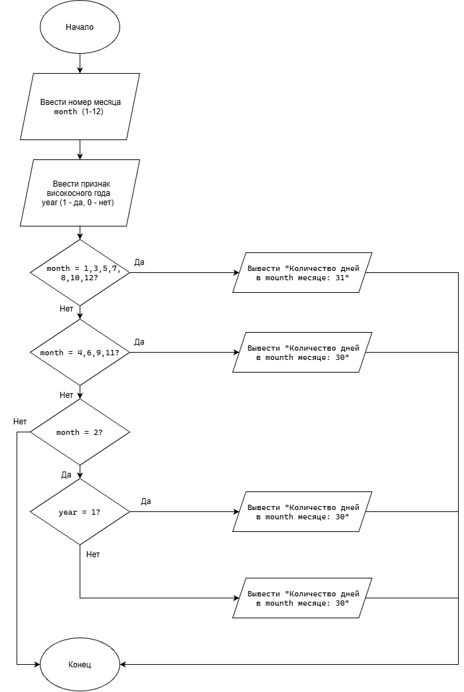

# LAB7DZ
# Домашнее задание (Условие)

**Задание 2.** Составить программу, которая в зависимости от порядкового номера месяца выводит количество дней в этом месяце. Предусмотреть возможность выбора года (високосный или не високосный).

# 1. Алгоритм и блок-схема

### Алгоритм

1. Объявить переменные `month`, `year`, `days` типа `int`.
2. Ввести с клавиатуры порядковый номер месяца от 1 до 12.
3. Предложить пользователю выбрать тип года:
   - `1` — високосный год.
   - `0` — невисокосный год.
4. С помощью оператора `switch(month)` определить количество дней в месяце:
   - Для месяцев 1, 3, 5, 7, 8, 10, 12 присвоить `days = 31`.
   - Для месяцев 4, 6, 9, 11 присвоить `days = 30`.
   - Для февраля использовать дополнительный оператор `switch(year)`:
     - При выборе `1` присвоить `days = 29`.
     - При выборе `0` присвоить `days = 28`.
     - При неверном выборе вывести сообщение об ошибке и завершить программу.
5. Если введён неверный номер месяца, вывести сообщение об ошибке и завершить программу.
6. Вывести количество дней в выбранном месяце.
7. Завершить программу.

## Блок-схема



# 2. Реализация программы

Программа написана на языке программирования C.

Для ввода данных используется функция `scanf()`, а для вывода информации — `printf()`.

В программе объявлены три целочисленные переменные:

- `month` — порядковый номер месяца.
- `year` — выбранный тип года (1 — високосный, 0 — невисокосный).
- `days` — количество дней в месяце.

Для определения количества дней используется оператор `switch(month)`.

Месяцы с одинаковым количеством дней объединены в группы операторов `case`.

Если пользователь выбирает февраль, выполняется вложенный оператор `switch(year)`, который определяет количество дней в зависимости от выбранного типа года.

Оператор `break` используется для завершения выполнения соответствующего блока `case`.

Оператор `default` обрабатывает неверный ввод данных.

При правильном вводе программа выводит количество дней в выбранном месяце.

# 3. Результаты работы программы

### Пример 1

Ввод:

```text
Введите номер месяца (1-12): 2
Год високосный? (1 - да, 0 - нет): 1
```

Вывод:

```text
Количество дней: 29
```

### Пример 2

Ввод:

```text
Введите номер месяца (1-12): 2
Год високосный? (1 - да, 0 - нет): 0
```

Вывод:

```text
Количество дней: 28
```

# 4. Информация о разработчике

**ФИО:** Гордиенко Владимир Денисович

**Группа:** бОТИ-261
